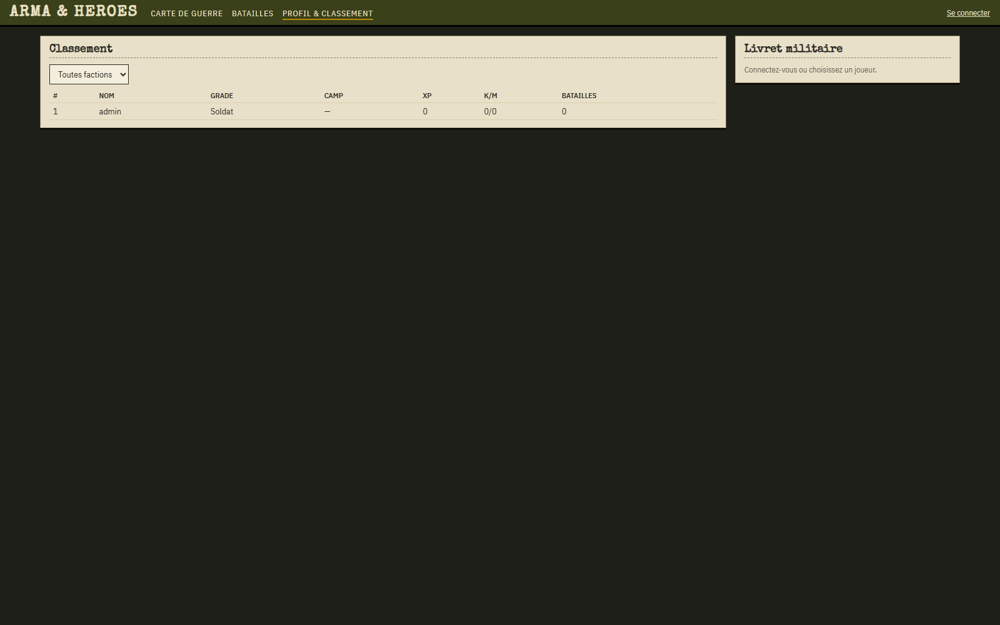
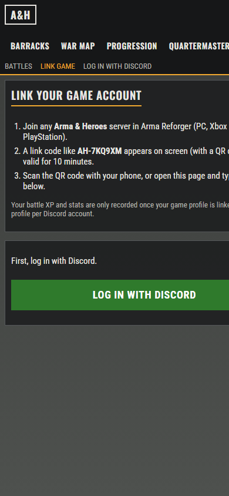
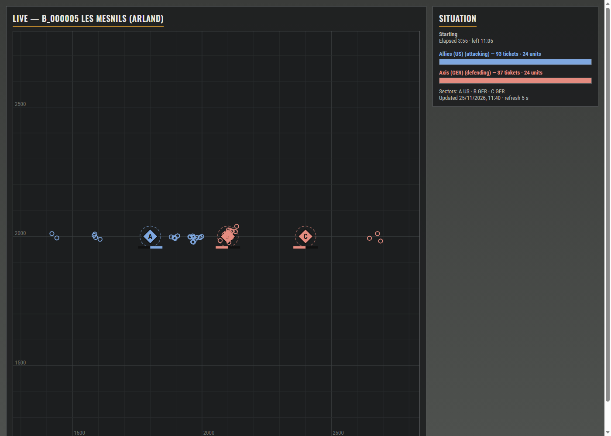

# Arma & Heroes

**A persistent WW2 war for Arma Reforger** — a strategic war map on the web drives real multiplayer battles on Reforger dedicated servers.
Inspired by the gameplay loop of the late *Heroes & Generals* (no affiliation, no assets from it).

> Status: **early development (V0–V2)**. Live demo war map: https://heroes.collectifxxl.fr
> Mod on the Workshop: **Arma & Heroes - Core** https://reforger.armaplatform.com/workshop/EAD65CE1E596E39C


## How it works

```
 Generals (web)                 Orchestrator (Windows host)            Reforger server (F44_Core mod)
 ──────────────                 ───────────────────────────            ──────────────────────────────
 buy Assault Teams      ──►     polls pending battles          ──►     loads BattleConfig from the API
 move them on the map           claims one, picks a free               spawns / classes / vehicles / tickets
 contact = battle created       server instance, writes config         come from the engaged Assault Teams
                                and starts the server                  sectors to capture (Assault / Skirmish)
 map updated with result ◄──    stops the instance             ◄──     POSTs BattleResult (losses, XP, winner)
```

1. **War map** — cities linked by supply roads, two factions (US / GER), resources earned per tick from held cities and factories.
2. **Assault Teams** — generals spend resources on teams: `INF`, `PARA`, `ARM` (armor), `REC` (recon), `MOT` (motorized). A team carries manpower (= tickets), vehicles and allowed classes.
3. **Battles** — when a team reaches an enemy city a battle is created. The Reforger match only offers what the engaged teams bring: soldier classes, vehicle pool, tickets.
4. **Results** — real losses are applied back to the teams, the city may change hands, players earn XP. A war is won by taking the enemy capital or 70 % of the cities.

## Repository layout

| Path | What |
|---|---|
| `web/` | War map site + REST API — Go (Gin, GORM), MariaDB, vanilla JS front, Docker Compose. See [`web/README.md`](web/README.md). |
| `orchestrator/` | Python (stdlib only) service that turns pending battles into running Reforger server instances. |
| `mod/F44_Core/` | Arma Reforger Workbench addon: battle game mode, sectors, tickets, vehicle pools, HUD, API client. |
| `catalog.json` | Logical keys (`US_RIFLEMAN`, `GER_SDKFZ222`, …) → Reforger prefabs. The web only knows the keys. |
| `inventory/` | Asset inventory of the WW2 mods we depend on + generator scripts. |
| `samples/battle.json` | Example `BattleConfig`, usable offline by the mod. |
| `PLAN.md` | Full design document and API contracts (French). |

## API contract (short)

- `GET /api/v1/battles?status=pending` — orchestrator polling
- `POST /api/v1/battles/{id}/claim` — reserve a battle (Bearer server key)
- `GET /api/v1/battles/{id}` — `BattleConfig` (sides, teams, classes, vehicles, tickets, scenario)
- `POST /api/v1/battles/{id}/heartbeat` / `result` — from the game server

Full JSON schemas: `PLAN.md` §3–§4.

## Mod dependencies

Built on top of community WW2 content — **we do not redistribute any of their assets**, only depend on them:

- **Finest Hour** (US / GER uniforms, gear, units, vehicles) by SalamiBoiDev and contributors
- WW2_Bicycle (62B4A8E40D31F94B, Modest23, APL) + Modest VehicleCore (6A7D4E7B69969355)
- Chungus Core / Bolt Guns, CIE Tracked Core / Thermal, WW2 Tank Core, M4A2 Sherman (Cole_reforge), Northcom German Voice Pack

Exact server mod list (Workshop IDs): [`docs/server-mods.json`](docs/server-mods.json).

## Getting started

**Web** — `cd web && cp .env.example .env` (set keys), `docker compose up --build -d`, reverse-proxy port 8080.
**Orchestrator** — edit `orchestrator/orchestrator.json` (API URL, server exe, instance pool), then `python orchestrator.py --dry-run --once` to test (add `--local-addon` to run an unpublished build from `localAddonsDir`), `start-orchestrator.bat` to run.

**Orchestrator as a service** — `start-orchestrator.bat` runs the long-lived loop (poll every `pollSec`) and restarts it 30 s after a crash. Safety: one loop at a time (`orchestrator.pid`, a second start exits with code 1), it only stops server PIDs whose command line points at its own instance profile, `orchestrator.log` rotates (2 MB x 5) and old server `logs_*` folders are pruned hourly (`keepServerLogs`, default 20 per instance). Dev: `python orchestrator.py --relaunch <battleId>` restarts a running battle after a mod change.
Start at boot with the Task Scheduler (no window, survives logoff):
```
schtasks /Create /TN "ArmaHeroes Orchestrator" /SC ONSTART /DELAY 0002:00 /RU %USERNAME% /RL LIMITED ^
  /TR "cmd /c D:\Serveur\ww2-heroes\orchestrator\start-orchestrator.bat"
```
(or a shortcut to the .bat in `shell:startup`). Stop it: end the `python orchestrator.py` process listed in `orchestrator.pid`, then its parent `cmd` (check the command line first: other Arma servers run on this machine).
**Mod** — open `mod/F44_Core/addon.gproj` in Arma Reforger Tools, play `F44_Test` with `samples/battle.json` copied to `$profile:F44/battle.json`.

## Roadmap

Done:
- [x] Website live: war map, Discord sign-in, anti-spoof account linking (one-time `AH-` codes + QR for console players), soldiers / arsenal / loadouts, admin AI settings, "Veteran" look
- [x] Battle orchestrator (instance pool, start/stop, results)
- [x] F44_Core mod V0 running on the dedicated server, Finest Hour factions
- [x] AI bots spawn per side, receive sector orders, bot deaths cost tickets
- [x] Live battle view (mod posts snapshots every 5 s, `/battle` page)
- [x] WW2 server with 22 mods incl. armor (Tiger I, Panzer IV / Sturmtiger, SdKfz 251, M3A1, Overlord US vehicles)
- [x] Content inventory vs Heroes & Generals (`inventory/HG_CONTENT.md`, `ARMOR_MODS.md`)
- [x] Real WW2 vehicles in the pools: Willys, WC-63, M3A1, SdKfz 251, Panzer IV G, Tiger I, Sherman (old web keys kept as catalog aliases)
- [x] AI in vehicles: armor teams crew tanks, other bots ride transports to the sector and unload (logged)
- [x] Player loadouts: FH classes in the spawn menu, 30/34 catalog items resolved, loadout logged at spawn
- [x] In-game HUD Style B + scoreboard (names, ticket bars, timer, sectors, AI/players, ammo)
- [x] Live map: real terrain extent measured by the mod (Arland 0..4096 m) and sent in the live snapshot
- [x] Orchestrator as a long-lived service (lock, restart, log rotation, Task Scheduler)
- [x] F44_Core published PUBLIC on the Workshop (`EAD65CE1E596E39C`); the WW2 server and orchestrator now run in Workshop mode (`-config`, mod auto-downloaded), `--local-addon` keeps the old CLI mode for unpublished dev builds
- [x] BattleResult POST retried 3x with backoff, HTTP 409 = already recorded (mod 1.0.1)
- [x] AI vehicles (mod 1.1.0): road-snapped waypoint chains, cruise speed, transports unload ~150 m out and the driver returns the vehicle to base, armor holds the sector edge, 2-6 road-side vehicle slots per side from the pools, movement telemetry in the log
- [x] City layouts on Arland (mod 1.1.0, `mod/F44_Core/Configs/F44/layouts.json`): Arleville, Beauregard, military base, airfield; website cityId -> layout (`cityMap`: arland-ville, arland-village, arland-ferme, arland-airfield), or battle `layout` / inline `layoutData`
- [x] Medical (mod 1.1.0, `docs/MEDICAL.md`): bandages for all, medic kit + full heal + revive, unconscious with 60 s bleed-out, heal/revive counters for ribbons
- [x] Field supply (mod 1.1.0, `F44_FieldSupply.c`): free AT crates (1 Panzerfaust 60 / Bazooka per player, carried only, + AT grenades, refill every N min) near spawns and sectors, ammo/med boxes (hold to resupply/heal, slow regen) that can be loaded on a vehicle as a mobile logistics point (resupplyGiven/boxHealGiven credits), vehicle storage disabled in battles
- [x] Free light vehicles (mod 1.1.0, `F44_CivVehicleSpawner.c`): WW2 bicycles (WW2_Bicycle by Modest23) and civilian cars/vans near each side spawn on the roads, capped per side, respawn when destroyed/abandoned; all counts/timers in battle `fieldSupply`

In progress:
- [ ] End-to-end result posting, proof of AI sector captures
- [ ] Live view terrain background + zoom

To do:
- [ ] Deploy web changes (team vehicle keys, live bounds) to the VM
- [ ] Tracked / half-track mod vehicles (M3A1, SdKfz 251, Panzer IV) still drive poorly under AI (wheeled jeeps reach 5-6 m/s); a stuck fallback unloads / holds in place after 3 re-routes
- [ ] Missing items: Thompson, M3 Grease, G43, FJ outfit (no prefab installed)
- [ ] HUD verified by compile + replicated state only: check it in a client session
- [ ] QR code drawn in-game
- [ ] Missing Finest Hour US classes (MG, medic, AT, engineer, crew, paratrooper)
- [ ] Soviet faction
- [ ] City scenarios on Arland
- [ ] Finest Hour authors' permission

## Screenshots

| Battles | Profile & leaderboard |
|---|---|
|  |  |

## Screenshots

- **War map** — the Normandy front with cities, assault teams and supply.
  
- **Battles** — ongoing and finished battles.
  
- **Progression** — leaderboard and service record.
  
- **Link your game account** — one-time code flow (desktop and mobile).
   
- **Live battle view** — real-time snapshot of a running battle.
  

## Contributing

Mod creators, mission makers and web devs welcome — open an issue.

## License

Code (web, orchestrator, scripts): MIT. Mod content: Arma Public License Share Alike (APL-SA). Third-party mods keep their own licenses.
