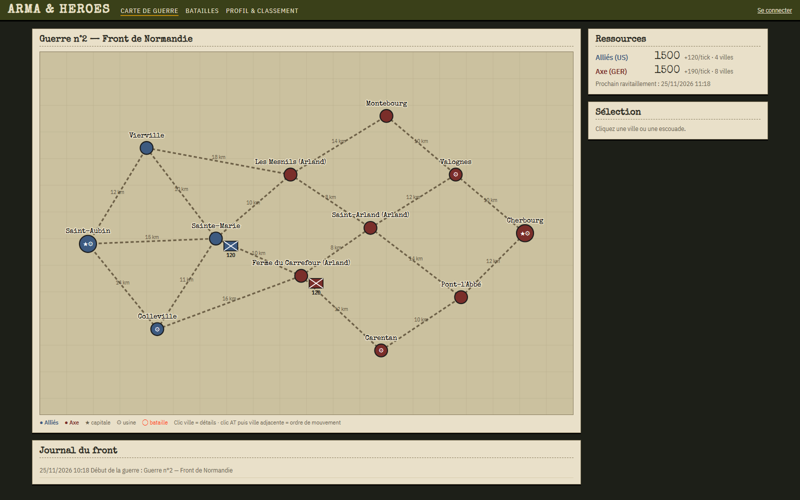
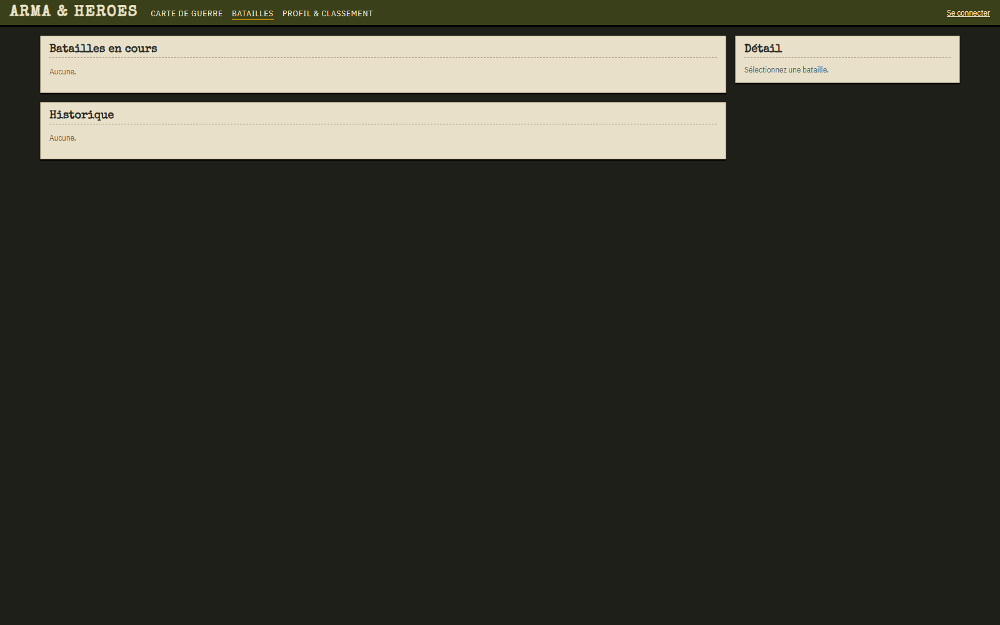
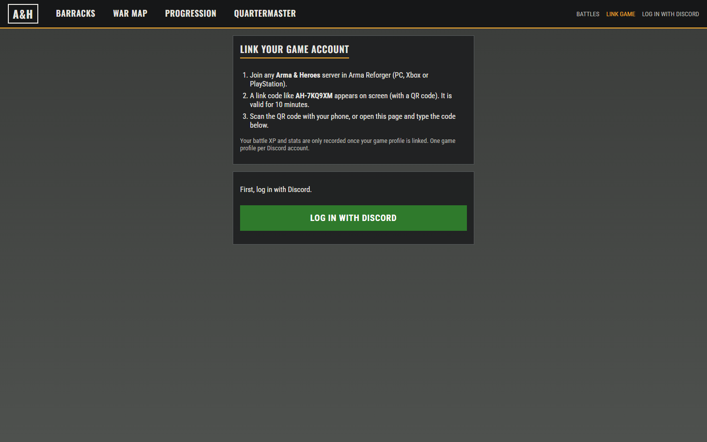

# Arma & Heroes

**A persistent WW2 war for Arma Reforger** — a strategic war map on the web drives real multiplayer battles on Reforger dedicated servers.
Inspired by the gameplay loop of the late *Heroes & Generals* (no affiliation, no assets from it).

> Status: **early development (V0–V2)**. Live demo war map: https://heroes.collectifxxl.fr



## How it works

```
 Generals (web)                 Orchestrator (Windows host)            Reforger server (F44_Core mod)
 ──────────────                 ───────────────────────────            ──────────────────────────────
 buy Assault Teams      ──►     polls pending battles          ──►     loads BattleConfig from the API
 move them on the map           claims one, picks a free               spawns / classes / vehicles / tickets
 contact = battle created       server instance, writes config         come from the engaged Assault Teams
                                and starts the server                  sectors to capture (Assault / Skirmish)
 map updated with result ◄──    stops the instance             ◄──     POSTs BattleResult (losses, XP, winner)
```

1. **War map** — cities linked by supply roads, two factions (US / GER), resources earned per tick from held cities and factories.
2. **Assault Teams** — generals spend resources on teams: `INF`, `PARA`, `ARM` (armor), `REC` (recon), `MOT` (motorized). A team carries manpower (= tickets), vehicles and allowed classes.
3. **Battles** — when a team reaches an enemy city a battle is created. The Reforger match only offers what the engaged teams bring: soldier classes, vehicle pool, tickets.
4. **Results** — real losses are applied back to the teams, the city may change hands, players earn XP. A war is won by taking the enemy capital or 70 % of the cities.

## Repository layout

| Path | What |
|---|---|
| `web/` | War map site + REST API — Go (Gin, GORM), MariaDB, vanilla JS front, Docker Compose. See [`web/README.md`](web/README.md). |
| `orchestrator/` | Python (stdlib only) service that turns pending battles into running Reforger server instances. |
| `mod/F44_Core/` | Arma Reforger Workbench addon: battle game mode, sectors, tickets, vehicle pools, HUD, API client. |
| `catalog.json` | Logical keys (`US_RIFLEMAN`, `GER_SDKFZ222`, …) → Reforger prefabs. The web only knows the keys. |
| `inventory/` | Asset inventory of the WW2 mods we depend on + generator scripts. |
| `samples/battle.json` | Example `BattleConfig`, usable offline by the mod. |
| `PLAN.md` | Full design document and API contracts (French). |

## API contract (short)

- `GET /api/v1/battles?status=pending` — orchestrator polling
- `POST /api/v1/battles/{id}/claim` — reserve a battle (Bearer server key)
- `GET /api/v1/battles/{id}` — `BattleConfig` (sides, teams, classes, vehicles, tickets, scenario)
- `POST /api/v1/battles/{id}/heartbeat` / `result` — from the game server

Full JSON schemas: `PLAN.md` §3–§4.

## Mod dependencies

Built on top of community WW2 content — **we do not redistribute any of their assets**, only depend on them:

- **Finest Hour** (US / GER uniforms, gear, units, vehicles) by SalamiBoiDev and contributors
- Chungus Core / Bolt Guns, CIE Tracked Core / Thermal, WW2 Tank Core, M4A2 Sherman (Cole_reforge), Northcom German Voice Pack

Exact server mod list (Workshop IDs): [`docs/server-mods.json`](docs/server-mods.json).

## Getting started

**Web** — `cd web && cp .env.example .env` (set keys), `docker compose up --build -d`, reverse-proxy port 8080.
**Orchestrator** — edit `orchestrator/orchestrator.json` (API URL, server exe, instance pool), then `python orchestrator.py --dry-run --once` to test, `start-orchestrator.bat` to run.
**Mod** — open `mod/F44_Core/addon.gproj` in Arma Reforger Tools, play `F44_Test` with `samples/battle.json` copied to `$profile:F44/battle.json`.

## Roadmap

- [x] V1 — war map, assault teams, orders, economy, battle API
- [x] V2 — battle orchestrator (instance pool, start/stop, results)
- [ ] V0 — playable battle game mode on a first map (in progress)
- [ ] City scenarios on several terrains (WW2 Arland, Montferrier 1944, Utah Beach…)
- [ ] Player progression (ranks, credits, unlocks), Discord login
- [ ] US vehicles / paratroopers / aircraft, USSR when a maintained WW2 faction exists

## Screenshots

| Battles | Profile & leaderboard |
|---|---|
|  |  |

## Screenshots

- **War map** — the Normandy front with cities, assault teams and supply.
  
- **Battles** — ongoing and finished battles.
  
- **Progression** — leaderboard and service record.
  
- **Link your game account** — one-time code flow (desktop and mobile).
   
- **Live battle view** — real-time snapshot of a running battle.
  

## Contributing

Mod creators, mission makers and web devs welcome — open an issue or join the Collectif XXL Discord.

## License

Code (web, orchestrator, scripts): MIT. Mod content: Arma Public License Share Alike (APL-SA). Third-party mods keep their own licenses.
