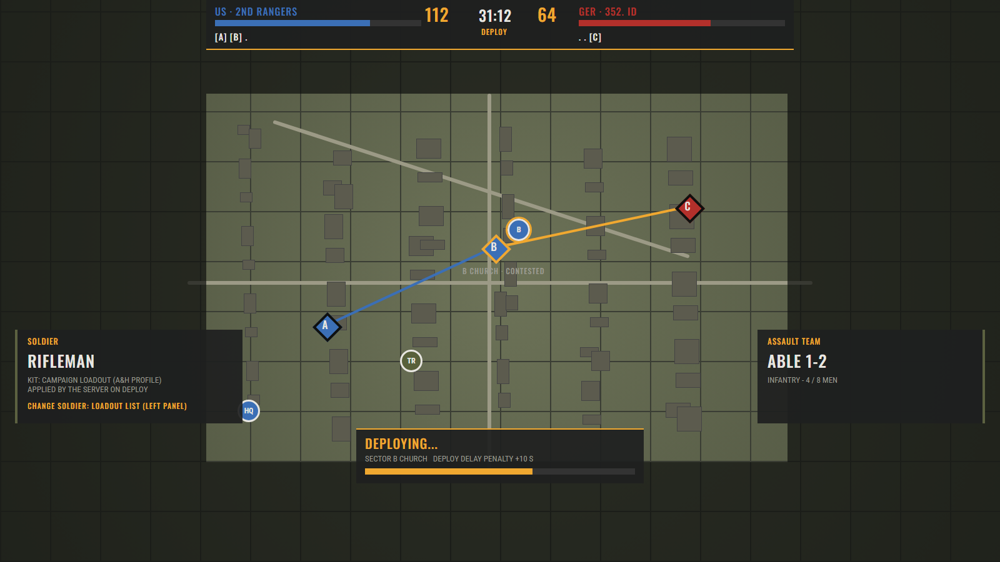

# Spawn / Deploy UI — "tactical overhead map"

## How vanilla does it (studied before coding)

- Menu: `SCR_DeployMenuMain` (`Scripts/Game/UI/Menu/DeployMenu/SCR_DeployMenuBase.c`), preset `ChimeraMenuPreset.RespawnSuperMenu`.
  It opens the map with `SCR_MapEntity.GetMapInstance()` in `EMapEntityMode.SPAWNSCREEN` (config `SCR_MapConfigComponent.GetSpawnMapConfig()`).
  The root handler `SCR_DeployMenuHandler` holds the loadout, group and spawn point selectors (`SCR_LoadoutRequestUIComponent`, `SCR_GroupRequestUIComponent`, `SCR_SpawnPointRequestUIComponent`).
- Spawn points: each `SCR_SpawnPoint` gets an `SCR_MapUISpawnPoint` icon (an `SCR_MapUIElement`) from `SCR_MapUIElementContainer`.
  A click fires `GetOnSpawnPointSelected()` (RplId), which calls the menu's `SetSpawnPointExt` → `SetSpawnPoint`.
  On gamepad, `NextSpawn` / `PrevSpawn` cycle the points.
- Spawning: `RequestRespawn()` sends `SCR_SpawnPointSpawnData(loadout, m_iSelectedSpawnPointId)` through `SCR_RespawnComponent.RequestSpawn`. The server validates the request (server authoritative).
- Deploy timer: `SCR_RespawnTimerComponent` (or `SCR_TimedSpawnPointComponent`) on the game mode.
  The countdown is `GetPlayerRemainingTime(playerId, spawnPoint.GetRespawnTime())`, and each point adds its own `m_fRespawnTime`.
- After spawning, the menu closes and goes straight to the character camera, with an optional fade (`SCR_MenuSpawnLogic`). Vanilla has no spawn cinematic.

## What F44 does

F44 already used vanilla spawning. `F44_CityLayout.ApplySpawns` replaces the HQ `SCR_SpawnPoint`s with the layout points, and `F44_GameModeComponent.ConfigureSpawnPoints` enables only the two battle factions. We keep all of that. Nothing new is decided client-side.

### Server: forward sector spawns — `Scripts/Game/F44/F44_SectorSpawn.c`

`F44_SectorSpawns.Tick` runs from `ServerTick`, right after `F44_SectorManager.Simulate`.

- A sector owned by a side becomes a spawn point for that side when it touches the front, meaning its neighbour in assault order is not owned by the same side.
- The point is a copy of that side's HQ spawn prefab, so the vanilla menu lists it, with:
  - name `SECTOR <name>`
  - `SetRespawnTime(10)`: the **deploy delay penalty**, enforced by the vanilla server timer.
- While the sector is contested (capture progress not full), the point is disabled.
- When the sector is lost or leaves the front, the point is deleted.
- Vehicles and logistics: any vanilla `SCR_SpawnPoint` attached to a vehicle shows up automatically.
  The F44_FieldSupply "loaded box" vehicles do not expose a spawn point yet (out of scope: another agent owns those files). Next step: add an `SCR_SpawnPoint` child to the loaded transport, plus the same penalty.

### Client: overlay on the vanilla menu — `Scripts/Game/F44/F44_DeployMenu.c`

`modded class SCR_DeployMenuMain` overrides `OnMenuOpen/Update/Close/Hide/FocusGained` and drives `F44_DeployOverlay`.

The overlay uses three layouts:
- `UI/layouts/F44_DeployOverlay.layout`
- `UI/layouts/F44_DeployMarker.layout`
- `UI/layouts/F44_DeployLink.layout`

All overlay widgets are `IGNORE_CURSOR`. Clicks and gamepad input still go to the vanilla map, icons and buttons, so console compatibility is unchanged.

| Element | Source |
|---|---|
| Fog outside the battle area (4 dark panels around the sectors' bounding box + 120 m) | `F44_SectorManager` centres → `SCR_MapEntity.WorldToScreen(..., withPan=true)` → `DPIUnscale`, recomputed every frame (pan/zoom) |
| Sector diamonds A/B/C (owner colour, amber ring = contested, sub-label) + links (amber = front, else owner colour) | `GetSectorOwners/GetSectorProgress` (RplProp) |
| Top bar: both sides' names, tickets, bars, sector pips `[A] [B] .`, timer | `F44_GameModeComponent` getters (same data as `F44_Hud`) |
| SOLDIER card | `SCR_PlayerLoadoutComponent.GetLoadout().GetLoadoutName()`; the soldier/loadout is changed with the vanilla loadout list (keyboard + gamepad). The real A&H kit is applied server-side at spawn (`F44_Loadout`), so the card says so. |
| ASSAULT TEAM card | `SCR_GroupsManagerComponent.GetPlayerGroup` → custom name or callsign, members / max |
| DEPLOY panel | "SELECT A SPAWN POINT" → "DEPLOY IN n S" (bar = vanilla timer + point penalty) → "READY" → "DEPLOYING..." (`m_bRespawnRequested`); shows `DEPLOY DELAY PENALTY +10 S` on forward points |

Spawn point icons and selection are the vanilla `SCR_MapUISpawnPoint` ones. We do not duplicate them.

## Not done / to verify

- **Descending top-down camera after spawn:** not implemented. Vanilla closes the menu immediately, so a camera would mean hooking `SCR_RespawnComponent` / a custom `CameraBase` after `OnRespawnResponse`. Planned as a follow-up. The vanilla fade is kept for now.
- **Rank and per-slot weapon icons on the SOLDIER card:** not shown. The client doesn't have the A&H loadout before spawn. Needs a small owner RPC from `F44_LoadoutService`.
- **Overlap:** the cards (bottom corners, Y −372) may overlap the vanilla left/right deploy panels at some resolutions. Adjust in `F44_DeployOverlay.layout` after an in-game look.
- **Verified:** compiles (dedicated server load of the addon, no `SCRIPT (E)` from F44 scripts).
- **Not verified in play:** visual rendering in-game, and forward-point creation (the test battle never reached a sector capture).

## Mobile spawn (implemented 1.2.0, `F44_MobileSpawn.c`)

Source of the mechanic: `inventory/HG_MECHANICS.md` section 12 (paraphrased; the wiki gives no numbers for conditions, so the values below are ours and tunable).

### Which of our vehicles
Only the infantry-support class, driven by the owner and matching H&G's 251/1 / M3 / cargo truck. Keys from `inventory/VEHICLES.md`, `VEHICLE_VARIANTS.md`, `web/teams.json` (`vehicleRoles`):

| Role | Prefab keys | Mobile spawn | Seats to count |
|---|---|---|---|
| `light_armored` halftrack | `GER_SDKFZ251` (+ `_TRANSPORT`, camo), `US_M3A1` (+ `_TRANSPORT`) | **yes**, main case | 8 rear cargo |
| `truck` | `GER_TRUCK`, `GER_TRUCK_OPEN`, `US_TRUCK` (WC-63 transport/covered) | yes (cheaper, 3 uses) | cargo |
| `light_utility`, bikes, armoured cars `GER_SDKFZ222`, tanks, planes | `GER_KFZ`, `US_JEEP`, `GER_PZ4`... | no (H&G: not spawn points) | n/a |

Armed and unarmed variants (`variants` in teams.json) behave the same; firing the MG reveals the position (UI hint only).

### Rules (server authoritative, 1.2.1 — H&G wiki "Action Rules")
1. The player spawns **directly inside** an active team vehicle, in a free seat (cargo first, then the other seats), not next to it. **No driver required, no stationary rule, no enemy-distance rule** (the 1.2.0 conditions were removed).
2. The point is **disabled** while the vehicle is full, out of uses (`usesHalftrack` 8 / `usesTruck` 3 / `usesTank` 99 per vehicle life) or in an optional `cooldownSec` (default 0). It is **removed** when the vehicle is destroyed.
3. **Lost for mobile spawn** (never registered again): an enemy-faction soldier entered it, or a member of **another assault team** entered it while it was empty.
4. **Mech infantry** (team types `mechTypes`, default `MECH`, `MOT`): at most `maxActiveMech` (1) active half-track per team. The pool refill (`CanSpawnForTeam`) only spawns a new half-track when the team has none on the map; it appears at the team's vehicle slot with its MOBILE point at once, so the player **spawns with the new vehicle** (inside it).
5. **Armor / TD teams** (`armorTypes`, default `ARM`, `TD`): every team vehicle is a mobile spawn, max `maxActiveArmor` (3) active tanks per team. H&G: these teams spawn only on their tanks — the infantry spawn is not blocked by the mod yet (web side gives them crew classes only).
6. **Paratroopers**: the C-47 follows the same seat logic (`F44_VehicleSeats`, cargo seats only); one plane per side via `airDrop.planeCount` (H&G: max one active plane per team).
7. **Deploy delay:** `penaltySec` 10 on the point = **20 s total** with the base 10 s.

### As implemented (1.2.1)
- `F44_MobileSpawns` (server) ticked in `ServerTick`; vehicles come from the tracked list (`Register(veh, key, faction, teamId, teamType)`, idempotent, also called right after each pool spawn so the cap counts it immediately).
- Seating: `modded SCR_SpawnPoint` (`F44_SetMobileVehicle`) → `CanReserveFor_S` (vehicle full = `NOT_ALLOWED_VEHICLE_FULL`), `PrepareSpawnedEntity_S` → `F44_VehicleSeats.Seat` (`SCR_CompartmentAccessComponent.GetInVehicle`, same as the C-47), `CanFinalizeSpawn_S` waits for the get-in.
- The menu point is created at the vehicle and re-created when the vehicle moved more than `moveRefresh` (30 m). Name `MOBILE <key> - <driver> (<uses left>)`.
- Battle JSON `mobileSpawn` (all optional): `enabled`, `usesHalftrack` 8, `usesTruck` 3, `usesTank` 99, `cooldownSec` 0, `penaltySec` 10, `maxActiveMech` 1, `maxActiveArmor` 3, `moveRefresh` 30, `halftrackKeys`, `truckKeys`, `mechTypes`, `armorTypes`. Obsolete 1.2.0 keys ignored: `requireDriver`, `maxSpeedKmh`, `stopSec`, `enemyRadius`, `driverAbsentSec`, `backOffset`.
- Logs: `Mobile spawn registered/created/ENABLED/DISABLED (reason)/removed (lost: ...)`, `Mobile spawn: seat N (CARGO) -> 1`.

### Spawn timers: H&G source vs ours
| Timer | H&G (wiki Action_Rules + Spawn_Time) | Arma & Heroes default | JSON |
|---|---|---|---|
| Base soldier respawn | 10 s (+0.5 s per link, + equipment points / distance terms) | 10 s, flat (vanilla `SCR_RespawnTimerComponent`) | `spawnTimes.baseSec` |
| Forward / capture point | no fixed value; distance from access point / objective | +10 s | `spawnTimes.forwardPenaltySec` |
| Half-track mobile | 20 s total ("fixed multiplier" on vehicle deploy) | +10 s (= 20 s total) | `mobileSpawn.penaltySec` |
| Para / air | 15 s, vehicle delay overrides | see F44_ParaDrop (not here) | n/a |
| Suicide / first join | extra penalty, no number | none | n/a |

### Original implementation plan (vanilla `SCR_SpawnPoint` on the vehicle)
No mod code edited here. Steps, in the order we would do them:
1. New `Scripts/Game/F44/F44_MobileSpawn.c`: `class F44_MobileSpawns`, owned by `F44_GameModeComponent` next to `m_SectorSpawns` and ticked from `ServerTick` right after `F44_SectorSpawns.Tick` (same hook, same server-only pattern).
2. Discovery: when a vehicle with role `light_armored`/`truck` is spawned by the F44 vehicle logic (or on `SCR_VehicleSpawnerComponent` / `F44_FieldSupply` loaded-box creation), register it. Resolve role from the prefab key via the same table as `web/teams.json` `vehicleRoles`.
3. Create the point exactly like `F44_SectorSpawns.CreatePoint`: spawn the faction's HQ `SCR_SpawnPoint` prefab (`FindHqPrefab`), **parent it to the vehicle** (`vehicle.AddChild(sp, -1)`, offset behind the tailgate, 3 m) so it follows the hull; set `SetSpawnPointName("MOBILE <name>")`, `SetRespawnTime(15)`, `SetFactionKey`. Enable/disable with `SetSpawnPointEnabled_S` from the rules above; delete on vehicle death (`SCR_DamageManagerComponent` `OnStateChanged` DESTROYED) or abandon timer.
4. Keep the point disabled by default; a per-vehicle record `{vehicle, point, uses, nextSpawnTime, abandonTimer}` lives in a `ref array`; `uses--` and cooldown set by hooking `SCR_SpawnPoint` spawn event (or `SCR_BaseGameMode.OnPlayerSpawned` + distance check to the point).
5. Client: no new work. The vanilla `SCR_MapUISpawnPoint` already lists any enabled point; `F44_DeployMenu.c` line ~428 uses `NAME_PREFIX` to show the `+10 S` penalty, so add a second prefix `MOBILE ` (+15 S) and a distinct overlay colour. Show remaining uses in the name string (updated server side, replicated by vanilla).
6. Test: Workbench MP with 2 clients, one driver; check enabled/disabled transitions, kill the vehicle, drive away, and a vehicle spawned by `F44_FieldSupply`.

Open points: (a) vanilla RplProp replication of a moving child spawn point (verify it re-sends position; fallback: delete/recreate every 5 s only when moved > 20 m); (b) numbers 40 m / 8 uses / 20 s are untested guesses.
